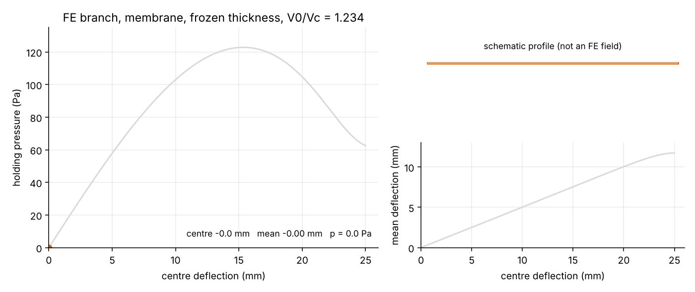
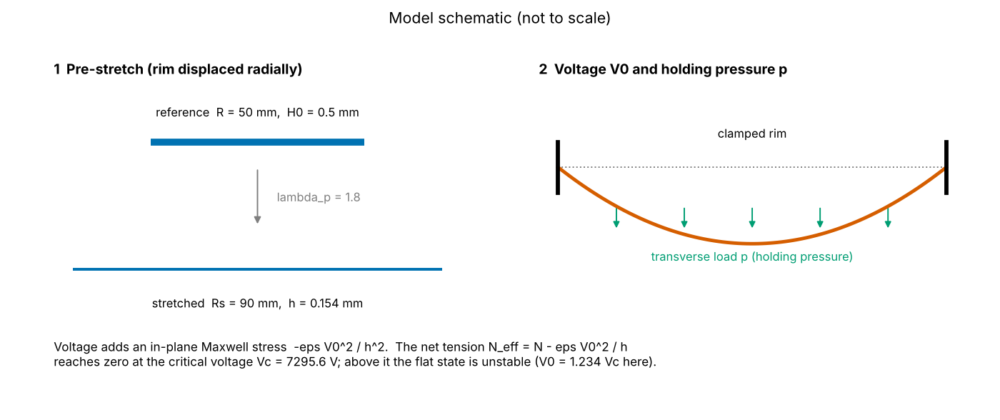
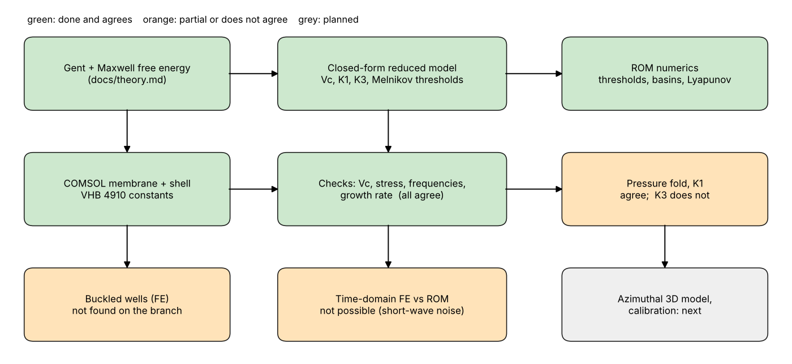
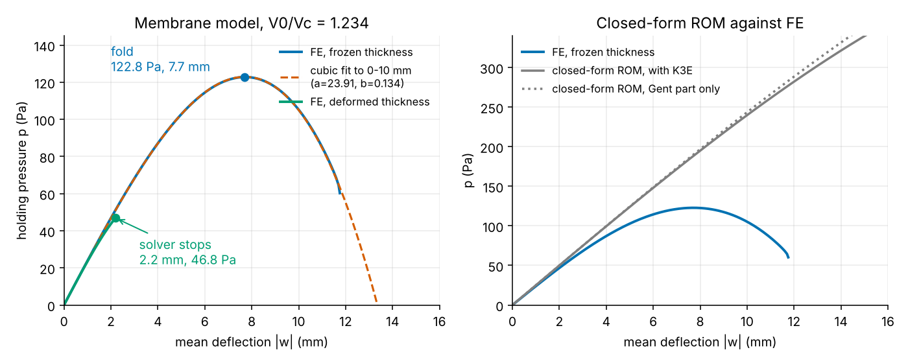
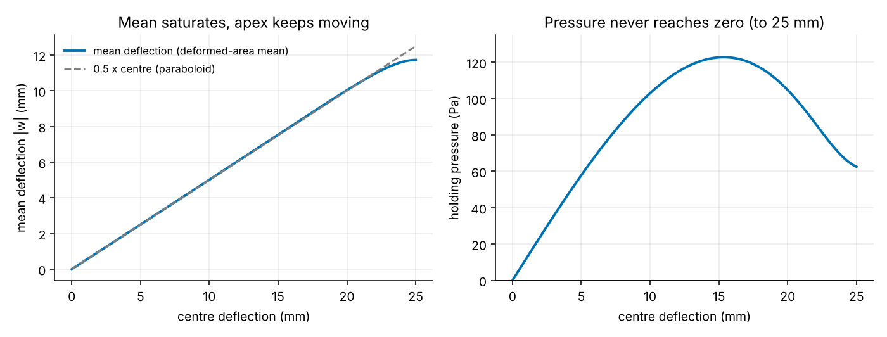
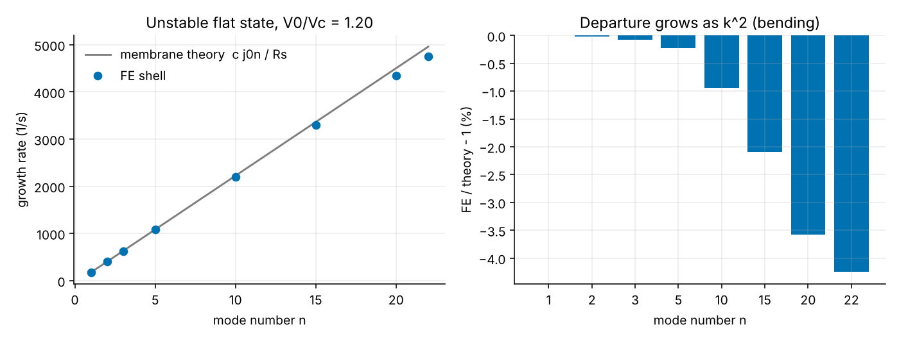
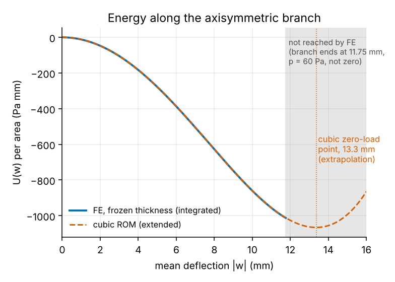

# Dielectric-elastomer membrane snap-through: Gent/Maxwell ROM and COMSOL verification

A pre-stretched dielectric-elastomer (DE) membrane under voltage loses its in-plane tension to the Maxwell stress and becomes unstable. This project builds an analytical reduced-order model (ROM) of the resulting snap-through, checks it against axisymmetric finite-element (FE) models in COMSOL Multiphysics 6.4, and records plainly where the reduced model holds and where it does not.

> **Status: research in progress, one author, not peer reviewed.** A manuscript on the spectral limits of the single-mode description (submitted to a Royal Society journal; this repository is its data and code supplement) is in preparation. FE runs use material constants from the published range for VHB 4910, not a fit to one film. No experiments were done. Every claim below carries its evidence level; see [Limitations](docs/limitations.md) before relying on a number.



*Animation of the centre-deflection-controlled FE run (membrane, frozen thickness, V0/Vc = 1.234). The pressure and mean-deflection curves are the real FE data, traced point by point. The dome in the upper right is a **schematic profile, not an FE field**; it is scaled only so that its mean deflection matches the FE value. Real COMSOL deformed shapes and mode animations are planned (see [Roadmap](#roadmap)).*

## Contents

1. [Motivation and problem](#1-motivation-and-problem)
2. [Model](#2-model)
3. [Method and workflow](#3-method-and-workflow)
4. [Results](#4-results)
5. [What is and is not shown](#5-what-is-and-is-not-shown)
6. [Glossary](#6-glossary)
7. [Repository layout](#7-repository-layout)
8. [Reproduce](#8-reproduce)
9. [Roadmap](#9-roadmap)
10. [Tools, author, licence](#10-tools-author-licence)

## What is new (November 2026)

Two supplements were added for the manuscript on the spectral limits of the single-mode description. Each folder has its own README with check values.

| Folder | Content | Result |
|---|---|---|
| [`spectral_limits/`](spectral_limits/) | Flat-state spectrum of the 2D axisymmetric shell (pinned and clamped rim), exact prestressed-plate dispersion, Table 7 crossings, exclusion criterion | Effective rigidity measured: $D_\text{eff}=6.73\times10^{-7}$ N m (pinned 6.738e-7, clamped 6.719e-7). Stable-side extrapolation puts the first two radial crossings at $x_c=2.20\times10^{-5}$ and $1.66\times10^{-4}$ (pinned), $9.17\times10^{-5}$ and $2.74\times10^{-4}$ (clamped), with $x=(V_0/V_m)^2-1$. |
| [`planar_dynamics/`](planar_dynamics/) | C-accelerated RK4 and Lyapunov code, basin and Poincare scripts, stored results for Tables 3-5 and Figs 5-7 | Reference first-order threshold $A_c=0.2044$; recomputed Lyapunov exponents match the stored ones exactly. |

**Exclusion criterion.** With $\Delta=(V_0/V_c)^2-1$ the forcing coefficients obey $g_3/g_1\le\Delta/(1+\Delta)$. The reference ratio $0.16$ needs $\Delta\ge0.19$, about 1,250 to 2,400 times the first competing $(1,1)$ crossing, so single-mode validity fails at those coefficients (`spectral_limits/exclusion_criterion.py`).

**Not established.** All COMSOL crossings are extrapolations from the stable side. The $(1,1)$ and $(2,1)$ crossings were not obtained from COMSOL (3D mesh mixes $n=0$ and $n=4$; the azimuthal-extension runs disagree with plate theory). The origin of $D_\text{eff}=0.59$ times the unstretched-plate rigidity is unidentified. The earlier membrane and shell studies below remain as the record of the first stage; their $K_3$ disagreement is unchanged.

## 1. Motivation and problem

A DE membrane is a thin elastomer film between compliant electrodes. Voltage squeezes it through the thickness and expands it in-plane, which removes pre-stress. Past a critical voltage the net in-plane tension is negative and the flat state is unstable, so the membrane can buckle into a dome and, if it is driven (for example by an aerodynamic load plus a voltage modulation), jump between the two dome states. That jump is the snap-through of interest.

The question is how much of that behaviour a few-degree-of-freedom model can capture. A reduced model is cheap enough to scan parameters, derive thresholds in closed form (a Melnikov criterion for homoclinic tangling) and study basins of attraction. Its value depends on whether its coefficients agree with a full finite-element model. This project tests that, step by step, and keeps the failures in view.

## 2. Model



*Schematic, not to scale.*

| Quantity | Value |
|---|---|
| Reference radius, thickness | $R=50$ mm, $H_0=0.5$ mm |
| Equibiaxial pre-stretch | $\lambda_p=1.8$, so $R_s=90$ mm, $h=0.15432$ mm |
| Gent shear modulus, locking parameter | $\mu=27.46$ kPa, $J_m=50$ |
| Density, relative permittivity | $\rho=960$ kg/m³, $\varepsilon_r=4.7$ (Keplinger et al. 2012; Molberg et al. 2009 report 4.65). $J_m=50$ is assumed; no source |
| Pre-stress, tension | $\sigma_0=93\,005$ Pa, $N=14.353$ N/m |
| Critical voltage | $V_c=7295.6$ V |

The reduced potential in the first axisymmetric mode is

$$V(x)=-\tfrac12K_1x^2+\tfrac14K_3x^4,\qquad K_1=K_G\Big[\Big(\tfrac{V_0}{V_c}\Big)^2-1\Big],$$

with closed-form $K_1$ and $K_3$ from the Gent energy and the Maxwell term. For $V_0>V_c$ the flat state is a maximum of $V$ and two wells sit at $x=\pm\sqrt{K_1/K_3}$. A second, azimuthal coordinate gives an O(2)-symmetric system with nine critical points and a lower "azimuthal pass" between the wells. A Melnikov function for the forced planar system gives two loop thresholds, $A_c^R=0.204$ and $A_c^L=0.334$. The full derivation is in [`docs/theory.md`](docs/theory.md).

## 3. Method and workflow



*Green: done and agrees. Orange: partial or does not agree. Grey: planned.*

1. **Theory.** Gent plus Maxwell free energy, mode-1 reduction, critical points, Melnikov criterion ([`docs/theory.md`](docs/theory.md)).
2. **ROM numerics.** Melnikov quadrature, manifolds, crossing tests, basin erosion, Lyapunov estimates ([`docs/numerical_methods.md`](docs/numerical_methods.md)).
3. **COMSOL models.** An axisymmetric membrane model and an axisymmetric shell model, both with the VHB 4910 constants above. The Maxwell stress is imposed as an in-plane Cauchy stress $-\varepsilon V^2/h^2$, with the thickness either frozen or taken from the deformed state.
4. **Checks against closed forms.** Pre-stress, frequency law, linear response, critical voltage, growth rate of the unstable flat state.
5. **Pressure-deflection through the fold.** A Global ODE adds a pressure unknown and a constraint on the mean (or centre) deflection, so the unstable part of the branch can be followed by controlling deflection instead of load ([`docs/comsol_validation.md`](docs/comsol_validation.md)).
6. **Calibration and azimuthal 3D model.** Planned.

## 4. Results

### 4.1 Checks that agree

| Check | FE | Reference | Difference |
|---|---|---|---|
| In-plane stress at 5850 V | 33 204 Pa | closed form | $\le0.11\%$ |
| Lowest frequency, 0 V | 41.858 Hz | 41.858 Hz | $<0.01\%$ |
| Frequency law $f_0\sqrt{1-(V/V_c)^2}$, 0-7 kV | 11.79 Hz at 7 kV | closed form | $\le0.015\%$ |
| Linear response to 0.1 Pa near $V_c$ | -0.2885 mm at 7350 V | $w_0/(1-(V/V_c)^2)$ | $\le0.06\%$ away from $V_c$ |
| Effective critical voltage | 7295.1-7295.5 V | 7295.6 V | $\le0.006\%$ |
| First-mode growth rate, $V_0/V_c=1.20$ | 174.5 s⁻¹ | 174.5 s⁻¹ | agrees |

The critical-voltage check tests pre-stress, thickness bookkeeping and the solver. The Maxwell stress is imposed in the same closed form, so it does not independently test the electromechanics.

### 4.2 Pressure against deflection



*Left: holding pressure against mean deflection in the membrane model. The frozen-thickness run passes the fold at 122.8 Pa and follows a cubic law to 11.7 mm. With the deformed thickness the solver stops at 2.2 mm and 46.8 Pa. Right: the closed-form ROM against FE. The slope agrees, the cubic term does not.*

| | Closed form ($V_0=9000$ V) | FE fit, frozen thickness (0-10 mm) |
|---|---|---|
| Slope $a$ (Pa/mm) | 25.05 | 23.91 |
| Cubic $b$ (Pa/mm³) | 0.0107 (with Maxwell cubic term), 0.0070 (without) | 0.134 |
| Fold | | 122.8 Pa at 7.7 mm |

$K_1$ agrees within 4.5%. The closed-form $K_3$ is 12 to 19 times too small for the frozen-thickness membrane and larger factors for the deformed-thickness fit and the shell (3.6 to 83 overall; see [`docs/comsol_validation.md`](docs/comsol_validation.md)). The ROM's cubic coefficient has to be calibrated, not taken from the formula.

### 4.3 Saturation beyond the fold



*Under centre-deflection control, the mean deflection saturates near 11.7 mm while the apex continues to 25 mm. The pressure falls to about 62 Pa and does not reach zero.*

No zero-pressure equilibrium (no buckled well) is found on this axisymmetric branch. The cubic fit puts a zero at 13.3 mm, but that is an extrapolation. Whether the true buckled states are non-axisymmetric or localised is the reason for the planned 3D model.

### 4.4 The unstable flat state has many faster directions



*Shell model at $V_0/V_c=1.20$: 22 unstable pairs, growth rates up to about $4.7\times10^3$ s⁻¹. The ROM keeps the slowest of them.*

Without bending stiffness, mode $n$ grows at $s_n=c\,j_{0,n}/R_s$, so growth rises linearly with $n$. Bending cuts the band off at a wavenumber set by $|N_\text{eff}|/D$. The consequence is practical: a time-domain FE run from the flat state fails within 0.7 ms through short-wave noise, so no FE against ROM time-domain comparison was possible (decision recorded in [`docs/limitations.md`](docs/limitations.md)).

### 4.5 Energy landscape



*Cubic-ROM landscape built from the FE fit. The well position is an extrapolation and not an FE result.*

### 4.6 Reduced-model numerics (analytical side)

| Item | Result |
|---|---|
| Melnikov loop thresholds | $A_c^R=0.204$, $A_c^L=0.334$ (manifolds reproduce both to 0.1%) |
| Planar crossing threshold | $\approx4.5\,A_c^L$ |
| Coupled (azimuthal pass) crossing threshold | $\approx1.17\,A_c^L$ (seed dependent, 1.08-1.39) |
| Escaped fraction, coupled, $A=0.10$ to $0.50$ | 4.9% to 58.3% |
| Largest Lyapunov exponent | negative (planar), about $+0.2$ (coupled, $A=0.39$, $0.50$) |

The Melnikov criterion marks the onset of homoclinic tangling. It is **not** a deterministic escape boundary: crossing needs more forcing. Details and caveats are in [`docs/numerical_methods.md`](docs/numerical_methods.md). The integrator, basin and Lyapunov scripts are in [`planar_dynamics/`](planar_dynamics/); the direct manifold-onset script is not yet included.

## 5. What is and is not shown

| Claim | Status |
|---|---|
| Closed-form pre-stress, frequency law, linear response, $V_c$ | Verified in FE |
| First-mode growth rate of the unstable flat state | Verified in FE |
| $K_1$ of the ROM | Agrees within 4.5% |
| Pressure fold | Found in FE (membrane and shell, frozen thickness) |
| $K_3$ of the ROM | **Does not agree; must be calibrated** |
| Buckled wells | **Not found** on the axisymmetric branch |
| Stability of the wells | **Not established** |
| Time-domain escape under forcing (FE) | **Not done** |
| Azimuthal pass in FE | **Not tested** (models are axisymmetric) |
| Coupled fluid-structure response | **Not done** |
| Calibrated ROM | **Not done** |

Two modelling choices change results and are stated, not hidden: the thickness law (frozen against deformed, which decides whether the fold is reached) and the 3.5 times difference in the cubic coefficient between the shell and the membrane model, which is unresolved. See [`docs/limitations.md`](docs/limitations.md).

## 6. Glossary

* **Fold** (limit point): maximum of the holding pressure along the branch, beyond which the deflection grows with falling load.
* **Well**: stable buckled equilibrium of the ROM potential, a minimum of $V$.
* **Holding pressure**: the load that holds a given deflection. Under deflection control it is an output, so unstable parts of the branch become reachable.
* **Frozen thickness**: the Maxwell stress uses the stretched thickness $h$ and ignores further thinning. **Deformed thickness**: it uses the current thickness.
* **Negative effective tension**: $N_\text{eff}=N-\varepsilon V^2/h<0$, the source of the flat-state instability above $V_c$.
* **Melnikov function**: first-order measure of the splitting between stable and unstable manifolds of the saddle. A simple zero means transverse intersection and a tangle.
* **Azimuthal pass**: a lower-barrier route between the wells through a non-axisymmetric mode.

## 7. Repository layout

```
README.md
docs/
  theory.md              analytical model and criterion
  numerical_methods.md   ROM numerics, with results
  comsol_validation.md   FE models, checks, pressure-deflection results, practical notes
  limitations.md         what is not shown, open questions, next steps
data/                    tables exported from COMSOL (see data/README.md)
rom/
  closed_form_coefficients.py       K1, K3, a, b from the formulas of docs/theory.md
  fit_cubic.py                      fit p = a|w| - b|w|^3 to FE data
  rom_release_prediction.py         single-mode release test (prediction only, not validated)
  make_figures.py                   regenerates fig1-fig4 from data/
  make_schematic_and_animation.py   regenerates fig5, fig6 and branch_trace.gif
figures/
models/                  COMSOL files (see models/README.md)
spectral_limits/         flat-state spectra, plate-dispersion fits, Table 7, exclusion criterion (own README)
planar_dynamics/         planar and coupled dynamics: Lyapunov, basins, Poincare sections (own README)
```

## 8. Reproduce

```bash
pip install -r requirements.txt
# supplements (run inside each folder; see their READMEs)
(cd spectral_limits && python3 fit_deff.py && python3 table7.py && python3 exclusion_criterion.py)
(cd planar_dynamics && python3 verify_lyap.py)   # compiles rk.c with gcc on first use
# earlier membrane study
python rom/closed_form_coefficients.py 9000    # V0 in volts; prints Vc, K1, K3, a, b
python rom/fit_cubic.py                        # fit to data/membrane_frozen_mean_control.csv
python rom/rom_release_prediction.py
python rom/make_figures.py
python rom/make_schematic_and_animation.py
```

`closed_form_coefficients.py 9000` returns $V_c=7295.6$ V, $a=25.05$ Pa/mm and $b=0.0107$ (with the Maxwell cubic term) or $0.0070$ (without). `fit_cubic.py` returns $a=23.91$ Pa/mm and $b=0.134$ for the 0-10 mm fit, with an RMS residual of 0.075 Pa. The COMSOL models open in COMSOL 6.4; see [`models/README.md`](models/README.md).

## 9. Roadmap

1. **Structured 3D or validated Fourier-sector model** to obtain the $(1,1)$ and $(2,1)$ crossings and test the azimuthal pass.
2. **Real COMSOL visuals** to replace the schematic dome: deformed shapes at the fold and at 11.7 mm, mode-shape animations, azimuthal buckled shapes, each labelled with its model and case.
3. **Calibration** of $K_3$ and the other ROM parameters against FE.
4. **Dynamic test** in a model where the short-wave band is suppressed, compared with the ROM release prediction.
5. **Aerodynamic loading** as a prescribed projected pressure (not real CFD).
6. **Direct manifold-onset script** (Table 3, "direct onset" column) and the trajectory counts of Table 5 added to `planar_dynamics/`.
7. **References** with checked bibliographic details in `docs/theory.md` section 7.

## 10. Tools, author, licence

COMSOL Multiphysics 6.4 (Membrane, Shell and Global ODE interfaces; eigenfrequency, stationary and time-dependent studies); Python with NumPy, SciPy and Matplotlib.

Pavan Kumar Karsinapu, ORCID 0009-0006-8040-5244. Code and text under the MIT licence (`LICENSE`).

## Reproducibility audit — 21 November 2026

The public model combines Gent elasticity, Maxwell stress and a Melnikov criterion. COMSOL Multiphysics 6.4 axisymmetric results support selected linear checks, not the complete nonlinear/forced response. See [execution and evidence notes](docs/VERIFICATION.md).
